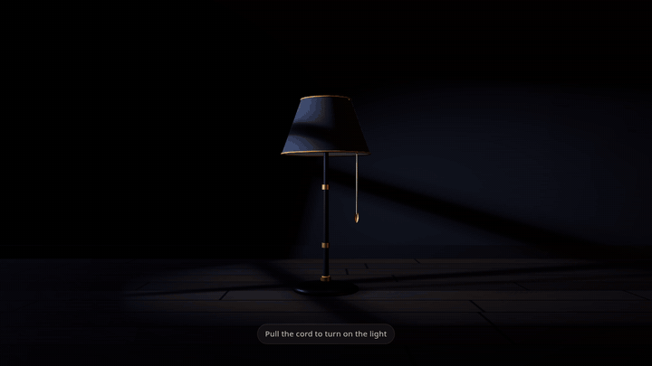

# Lamp Portfolio 3D

A portfolio page with a real-time 3D desk lamp. Pull the cord, the light turns on, and your work appears in the light.



**Live demo:** https://tam-leal.github.io/lamp-portfolio/

All names, companies, projects, metrics and links in this repository are **fictional sample content** (the person "Daniel Hayes" does not exist). Replace everything with your own before using it as a real portfolio.

## Features

- 3D desk lamp rendered with Three.js and WebGL, with a real spotlight, soft shadows, a light cone and dust in the air
- Pull cord with spring physics. Drag it, click it, or use the keyboard. Only the cord toggles the light, clicking the lampshade does nothing
- Cool street moonlight with a window shadow while the lamp is off, and an occasional passing headlight
- Content appears (and becomes focusable) only when the light is on, with a soft peek of the first project to invite scrolling
- Work grouped in blocks by specialty or stack, one full width row per project separated by a thin gold line
- Mouse parallax while the light is on
- Click sound synthesized with Web Audio (no audio files), with a small mute button
- Plain HTML, CSS and vanilla JavaScript. No framework, no backend, no tracking, no network requests
- Responsive: on a phone the lamp sits on top and scrolls away with the page

## Run it

Nothing to install. The repository ships with a ready-made build.

1. Double click `index.html`. It works from `file://` because `assets/lamp3d.js` is one plain script with Three.js included.
2. Or serve the folder with any static server, for example `python3 -m http.server 8080`, then open http://localhost:8080/.

All paths are relative, so it also works from a subfolder of an existing site.

## Edit the content

Open `index.html` and edit the `window.PORTFOLIO` object at the top of the file. It is documented in a comment right above it. No build step is needed.

| Key | What it controls |
| --- | --- |
| `showSampleNote`, `sampleNote` | The "Sample content" note in the hero and footer. Set `showSampleNote` to `false` when the content is yours. |
| `name`, `title`, `statement` | The hero. |
| `blocks` | Groups of work. Each block has a `title` and a list of `projects`. Blocks are lettered A, B, C and projects are numbered A-01, A-02 automatically. Set `code` on a block to pick its letter. |
| project fields | `title`, `summary`, `impact` (one line metric), `stack` (list), `status`, `links` (list of `label` and `href`, or an empty list). |
| `tools` | Groups for the "Tools in use" section: `group` and `items` (list). |
| `contact` | `intro`, `email` and `links` (list of `label` and `href`). |

Notes:

- All text is inserted as plain text, so no HTML is needed (and none is interpreted). Only `https:`, `http:` and `mailto:` links are used.
- Also update the `<title>` and the meta description in the `<head>`.
- Project rows are text only and are not clickable on purpose. Links live inside each row.

## Lighting options

Edit the `window.LAMP_CONFIG` object in `index.html`. Keep `mode: 'portfolio'`.

| Option | Default | Description |
| --- | --- | --- |
| `mode` | `portfolio` | Layout of the lamp and the content. |
| `lightColor` | `#ffb867` | Color of the lamp light. |
| `streetLightColor` | `#9bb0d4` | Color of the street light while the lamp is off. |
| `streetLightIntensity` | `1` | Strength of the street light. `0` is fully dark. |
| `streetWindow` | `true` | Shows a window shaped shadow in the street light. |
| `streetPassingCars` | `true` | Lets a headlight pass now and then. |

Page colors, spacing and type are CSS variables at the top of the `<style>` block in `index.html`.

## Browser support and accessibility

- Needs WebGL. Without it the 3D canvas is replaced by a simple CSS glow fallback, and the button still turns the light and the content on.
- Respects `prefers-reduced-motion`: animations are reduced to short fades.
- Keyboard: Tab to the cord button, press Enter or Space to toggle the light. Escape returns focus to the cord.
- The cord button has an `aria-label` and `aria-pressed` that follow the light state. The content is inert while the light is off, so keyboard users cannot tab into hidden content.
- The 3D canvas is decorative and hidden from assistive technology.

## Project structure

```
lamp-portfolio/
|-- index.html                 the page, with the content config at the top
|-- assets/
|   `-- lamp3d.js              bundled 3D scene (Three.js included), built from src/main.js
|-- src/
|   `-- main.js                readable source of the 3D scene
|-- docs/
|   `-- demo.gif               demo shown in this README
|-- build.mjs                  bundles src/main.js into assets/lamp3d.js
|-- package.json
|-- package-lock.json
|-- .github/workflows/pages.yml
|-- LICENSE
`-- THIRD_PARTY_LICENSES.md
```

## Build the 3D scene (optional)

You only need this if you change `src/main.js`. Node.js 18 or newer.

```
npm ci
npm run build
```

This rewrites `assets/lamp3d.js`. Three.js is pinned to 0.186.1 and esbuild to 0.28.2.

## Deploy to GitHub Pages

The workflow in `.github/workflows/pages.yml` publishes `index.html`, `assets` and `docs`. In the repository go to Settings, then Pages, and set Source to "GitHub Actions". Pushing to `main` deploys the site.

## About this project

This is an original implementation inspired by the general idea of a lamp login or portfolio interface. No code or assets from other projects were copied. The lamp, light, cord, shaders and page are built from scratch with Three.js.

## License

MIT, Copyright (c) 2026 Tam-Leal. See [LICENSE](LICENSE).

Third-party software is listed in [THIRD_PARTY_LICENSES.md](THIRD_PARTY_LICENSES.md). Three.js is MIT licensed and is included in `assets/lamp3d.js`.
